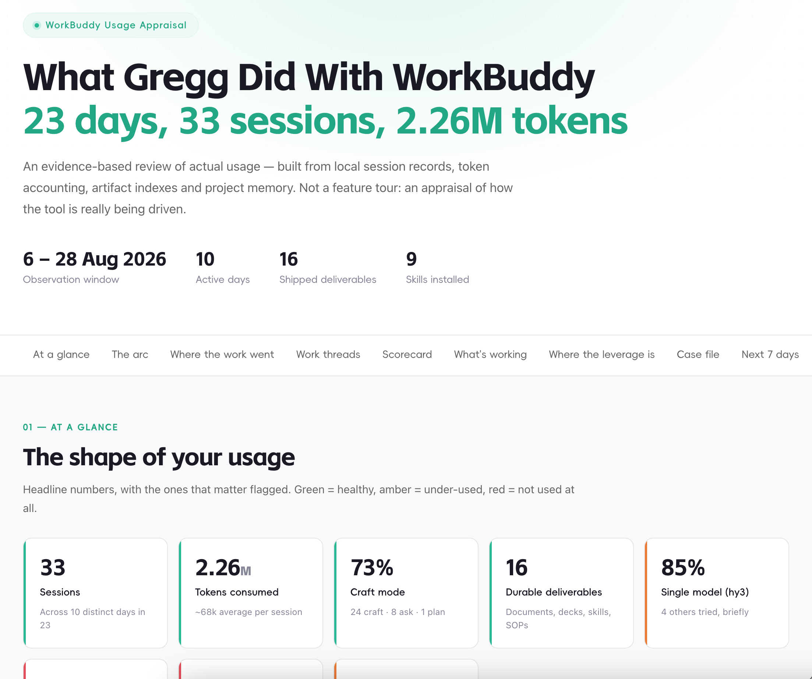

<p align="center">
  <b>Language / 语言:</b>
  <a href="./README.md">English</a> ·
  <a href="./README.zh-CN.md">简体中文</a>
</p>

# workbuddy-insights

Generate an evidence-based **"What I did with WorkBuddy"** usage appraisal from **local state only** — the WorkBuddy equivalent of Microsoft's *What I did with Copilot*. Every claim is derived from data on disk (session DB, artifact index, usage log, project memory); nothing is inferred from the live conversation.

As of the 2026-11-19 revision you choose the reporting window, a deterministic stdlib script computes every number into a JSON evidence payload, and each claim in the HTML carries a method label (`data` / `rule` / `judgement`). No dollar-value or time-saved estimates are used — those would be external assumptions, not local evidence.



## What It Does

- **Chosen reporting window** — pick last 30 days, last 90 days, all history, or a custom range. The old "first..last session" behaviour silently widened every run; a fixed window makes trend lines comparable. An optional recurring run can be set up afterwards, only on explicit opt-in.
- **Deterministic evidence payload** — `scripts/compute.py` (stdlib-only `/usr/bin/python3`, read-only) reads all eight sources and writes `workbuddy-insights-payload.json`: headline counts, one row per session, deduped deliverables with existence flags, per-source coverage, and a rule-based thread baseline. **Every number in the HTML comes from that file — no hand arithmetic.** The script fails closed on a missing DB, schema error, or failed reconciliation.
- **Work-thread grouping** — starts from the deterministic `cwd` baseline, then splits/merges into topic threads as a *labelled judgement*, so you can see where the compute actually went and how the grouping was decided.
- **Claim provenance** — every stat card, thread card and score chip shows `data` / `rule` / `judgement`, with the reason on hover. A model review that contradicts a measured value is flagged `review-rejected` and the baseline is kept. Scores are never laundered as "measured".
- **Project-memory read-through** — reads every `<project>/.workbuddy-ai/memory/*.md` to capture the *why* and the *friction* that raw counts can't.
- **Deliverable verification** — cross-checks the artifact index against the filesystem; an indexed artifact that's missing on disk is a finding, not a footnote.
- **Hygiene & MCP audits** — greps transcripts for leaked API keys, and flags configured-but-unloaded MCP servers you have a standing instruction to use.
- **Six-dimension scorecard** — Artifact orientation, Institutional memory, Verification discipline, Orchestration, Operational hygiene, Platform surface. Each scored 0–10 with a cited evidence line.
- **Ranked gaps & next actions** — gaps ranked by return-on-effort, plus ≤5 sequenced next actions with effort tags.
- **Anti-sycophancy built in** — no strength without a citable data line; every inference is labelled; post-hoc narrative risk is stated explicitly.

## Install

Just tell WorkBuddy:

> Install workbuddy-insights skill from https://github.com/greggchen308/gc-skills/tree/main/workbuddy-insights

## Invoke

```
/workbuddy-insights
```

## Data Sources (all local, read-only)

| Source | Path | Yields |
|---|---|---|
| Session DB | `~/.workbuddy-ai/workbuddy.db` (sqlite3) | sessions, usage, automations, workspaces |
| Artifact index | `~/.workbuddy-ai/artifact-index/*.json` | every file produced, keyed by session id |
| Usage log | `~/.workbuddy-ai/usage-log.json` | skill + MCP usage dates, active days |
| Plans | `~/.workbuddy-ai/plans/*.md` | plan-mode artefacts |
| Teams | `~/.workbuddy-ai/teams/*/config.json` | multi-agent orchestration evidence |
| Project memory | `<project>/.workbuddy-ai/memory/*.md` | narrative of what was done and why |
| Skills | `~/.workbuddy-ai/skills/*/SKILL.md` | what's installed vs used |
| MCP config | `~/.workbuddy-ai/mcp.json` | configured connectors |

## How It Works

1. **Ask one question** — which period to cover (30 / 90 days, all history, or a custom range). Recurring delivery is a separate, later question.
2. **Run `scripts/compute.py`** with that window. It reads all eight sources read-only and writes the JSON evidence payload; all arithmetic happens here.
3. **Pull headline counts from the payload**, not from fresh ad-hoc queries — sessions, days, tokens, modes, models, experts, automations.
4. **Group into work threads** from the payload's `cwd` rule baseline; splits/merges are labelled judgements.
5. **Read every project memory file** — the highest-value source in the whole exercise.
6. **Verify deliverables exist on disk** against the payload's deduped artifact list, splitting "missing" into discarded scratch vs migrated files.
7. **Hygiene audit** — grep for leaked keys; check the secret-handling standard in `~/.workbuddy-ai/MEMORY.md`.
8. **MCP audit** — configured-vs-live (server names only, no credentials); flag unloaded servers you rely on.
9. **Score six dimensions** 0–10, each with cited evidence **and** a `judgement` label.
10. **Rank gaps by return-on-effort**, not severity; end with ≤5 sequenced actions with effort tags.

## Output

Two files in `<workspace>/outputs/`:

- `workbuddy-insights-payload.json` — the machine-readable snapshot and audit trail, with a `run_id` cited in the report.
- `workbuddy-usage-appraisal.html` — the single self-contained HTML report, rendered in the official workbuddy.ai brand visual language (mint-green `#28b894`, Alimama fonts, white/near-white surfaces), then opened for review. Sections: hero + headline stats, at-a-glance stat cards, a 4-phase arc timeline, token bar chart, work-thread cards, scorecard, what's-working, leverage points, one failure post-mortem, next-7-days actions, and method & caveats (window, `run_id`, source coverage, claim-provenance counts).

The HTML is the deliverable; the JSON is the evidence.

## Notes & Caveats

- `last_activity_at - created_at` is **not** time-worked — reopened sessions span multiple days. Never report it as duration.
- The artifact index counts *records*, not unique files — de-duplicate by name; exclude memory / intermediate / `/tmp` scripts. `missing_on_disk` is a raw count, **not** data loss.
- The `cwd` thread baseline is degenerate for timestamped per-session workspace folders; disclose it rather than presenting a clean-looking taxonomy.
- The payload is a point-in-time snapshot: token counts for the active session keep growing, so two runs of the same window can differ.
- Method labels describe **how a claim was produced**, not whether it would have predicted anything in advance. Thread groupings and scores are retrospective classifications.
- The most instructive section is the post-mortem of an **abandoned** session — prefer it over another success story.

## See Also

- `SKILL.md` — full trigger conditions, sqlite query snippets, the compute-payload contract, claim provenance rules, the six-dimension scoring rubric, and the complete visual-language token spec.
- `scripts/compute.py` — stdlib-only, read-only evidence builder. Run with `/usr/bin/python3`, never a WorkBuddy managed runtime.
