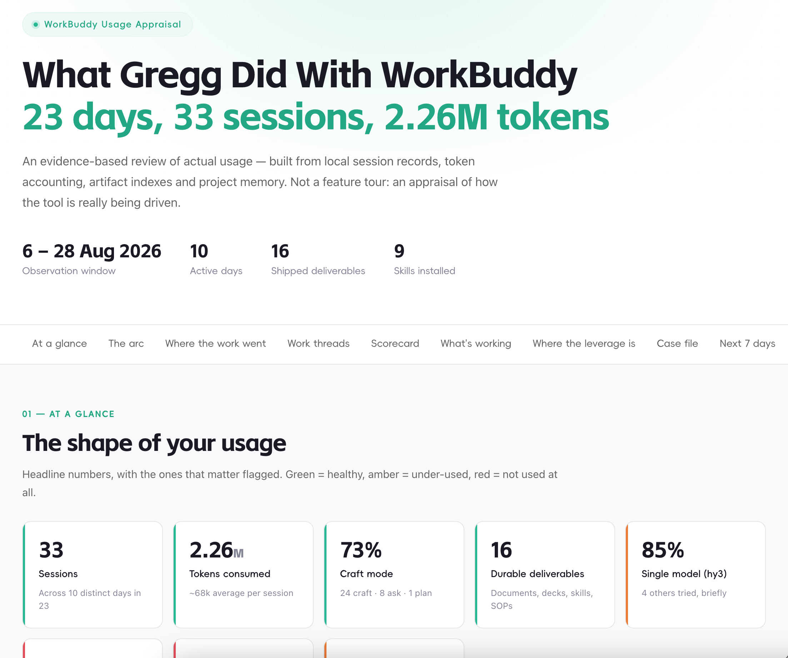

<p align="center">
  <b>Language / 语言:</b>
  <a href="./README.md">English</a> ·
  <a href="./README.zh-CN.md">简体中文</a>
</p>

# workbuddy-insights

基于本地状态数据,生成一份有据可查的 **"我拿 WorkBuddy 做了什么"** 使用回顾报告 —— WorkBuddy 版的微软 *What I did with Copilot*。每一条结论都来自磁盘上的真实数据(会话数据库、产物索引、用量日志、项目记忆),绝不由当前对话推断。

2026-11-19 修订版:由你选择统计窗口;一个仅依赖标准库的确定性脚本把所有数字算进一份 JSON 证据载荷;报告里每条结论都带方法标签(`data` / `rule` / `judgement`)。不使用"节省时间 / 金额估值"这类外部估算 —— 它们不是本地证据。



## 它能做什么

- **自选统计窗口** —— 最近 30 天 / 90 天 / 全部历史 / 自定义区间。旧版"取最早与最近会话"会让每轮分母悄悄变大,趋势无法比较。报告交付后可另行选择是否定期自动运行(须明确同意)。
- **确定性证据载荷** —— `scripts/compute.py`(仅标准库、`/usr/bin/python3`、只读)读取全部 8 个数据源,写出 `workbuddy-insights-payload.json`:总体指标、每行一条会话、去重后的交付物与存在性标记、各来源覆盖情况、基于规则的主线基线。**HTML 里每个数字都来自该文件,不做手工算术。** 数据库缺失、schema 报错或内部对账失败时脚本直接失败且不生成载荷。
- **工作主线归并** —— 从确定性的 `cwd` 规则基线出发,再按主题拆分 / 合并;后者是**带标签的判断**,让你既能看清算力去向,也能看清归并是怎么决定的。
- **结论来源标注** —— 每张统计卡、主线卡、评分卡都标注 `data` / `rule` / `judgement`,悬停可看理由。模型复核若与实测值冲突,标记为 `review-rejected` 并保留基线;评分绝不被包装成"测得"。
- **项目记忆回读** —— 读取每个 `<project>/.workbuddy-ai/memory/*.md`,还原数字背后的 *为什么* 和 *卡点*。
- **交付物核验** —— 交叉对比产物索引与文件系统;索引里有但磁盘上缺失的文件,本身就是一条发现,而不是脚注。
- **卫生与 MCP 审计** —— 在历史记录中检索泄露的 API key;标记"已配置但未加载"、且你本就打算使用的 MCP 服务。
- **六维度评分卡** —— 产物导向、机构化记忆、核验纪律、编排能力、运营卫生、平台覆盖面。每项 0–10 分,附一条引证。
- **差距与行动排序** —— 按"投入产出比"而非"严重程度"对差距排序;末尾给出 ≤5 条带工时标签的连续行动。
- **内置反谄媚规则** —— 没有引证就没有加分;每条推断都标明;后见之明的叙事风险会显式声明。

## 安装

直接告诉 WorkBuddy:

> Install workbuddy-insights skill from https://github.com/greggchen308/gc-skills/tree/main/workbuddy-insights

## 调用

```
/workbuddy-insights
```

## 数据来源(全部本地、只读)

| 来源 | 路径 | 提供 |
|---|---|---|
| 会话数据库 | `~/.workbuddy-ai/workbuddy.db`(sqlite3) | 会话、用量、自动化任务、工作区 |
| 产物索引 | `~/.workbuddy-ai/artifact-index/*.json` | 每个产出文件,按会话 id 关联 |
| 用量日志 | `~/.workbuddy-ai/usage-log.json` | 技能与 MCP 调用日期、活跃天数 |
| 计划 | `~/.workbuddy-ai/plans/*.md` | 计划模式产物 |
| 团队 | `~/.workbuddy-ai/teams/*/config.json` | 多智能体编排证据 |
| 项目记忆 | `<project>/.workbuddy-ai/memory/*.md` | 做了什么、为什么 |
| 技能 | `~/.workbuddy-ai/skills/*/SKILL.md` | 已安装 vs 实际使用的技能 |
| MCP 配置 | `~/.workbuddy-ai/mcp.json` | 已配置的连接器 |

## 工作流程

1. **只问一个问题** —— 覆盖哪个时间段(30 / 90 天、全部历史或自定义区间)。是否定期运行是之后单独再问的问题。
2. **运行 `scripts/compute.py`**,以该窗口只读扫描全部 8 个数据源并写出 JSON 证据载荷;所有算术都在这里完成。
3. **从载荷读取总体指标**,不再临时手写查询 —— 会话、天数、token、模式、模型、专家、自动化任务。
4. **按主线归并** —— 以载荷里的 `cwd` 规则基线为起点,拆分 / 合并属于带标签的判断。
5. **逐份读取项目记忆** —— 整个回顾中信息密度最高的一环。
6. **核验交付物** —— 比对载荷中去重后的产物清单,把"缺失"拆成"有意丢弃的草稿"与"已迁移他处"两类。
7. **卫生审计** —— 检索泄露的密钥,并对照 `~/.workbuddy-ai/MEMORY.md` 中的密钥处理规范。
8. **MCP 审计** —— 检查"已配置 vs 实际可用"(只输出服务名,不含凭据),标记你依赖却未加载的服务。
9. **六维度评分** —— 每项 0–10 分,附引证 **及** `judgement` 标签。
10. **按"投入产出比"对差距排序**,而非按严重程度;末尾给出 ≤5 条带工时标签的连续行动。

## 输出

`<workspace>/outputs/` 下两个文件:

- `workbuddy-insights-payload.json` —— 机器可读的快照与审计凭据,报告中会引用它的 `run_id`。
- `workbuddy-usage-appraisal.html` —— 独立的 HTML 报告,采用 workbuddy.ai 官方品牌视觉(薄荷绿 `#28b894`、阿里妈妈字体、白色 / 近白底),并自动打开供查阅。包含:首屏 + 头条数据、一览统计卡、4 阶段弧线时间轴、token 柱状图、工作主线卡、评分卡、亮点、发力点、一份失败复盘、接下来 7 天的行动清单,以及方法与局限性(窗口、`run_id`、来源覆盖、结论来源计数)。

HTML 是交付物,JSON 是证据。

## 注意事项与局限性

- `last_activity_at - created_at` **不能**当作"投入时间"——重新打开过的会话会跨多天,绝不要把差值当作时长。
- 产物索引统计的是 *记录数* 而非唯一文件数——需要按文件名去重,并排除记忆文件、中间产物、`/tmp` 脚本。`missing_on_disk` 只是原始计数,**不等于数据丢失**。
- `cwd` 主线基线在"按会话建时间戳目录"的情况下会退化成大量单会话主线;要如实说明,不要包装成一套漂亮分类。
- 载荷是某一时刻的快照:当前会话的 token 仍在增长,同一窗口两次运行的结果可以不同。
- 方法标签只说明**结论是怎么产生的**,不代表它能事前预测什么。主线归并和评分都是事后分类。
- 最有教益的部分是**被放弃**会话的事后复盘——它揭示的成功故事所掩盖的运行模式。优先写它,而不是又一份成功故事。

## 另见

- `SKILL.md` —— 完整的触发条件、sqlite 查询样例、证据载荷契约、结论来源标注规则、六维度评分细则,以及完整的视觉令牌规范。
- `scripts/compute.py` —— 仅标准库、只读的证据构建脚本。请用 `/usr/bin/python3` 运行,不要用 WorkBuddy 托管运行时。
